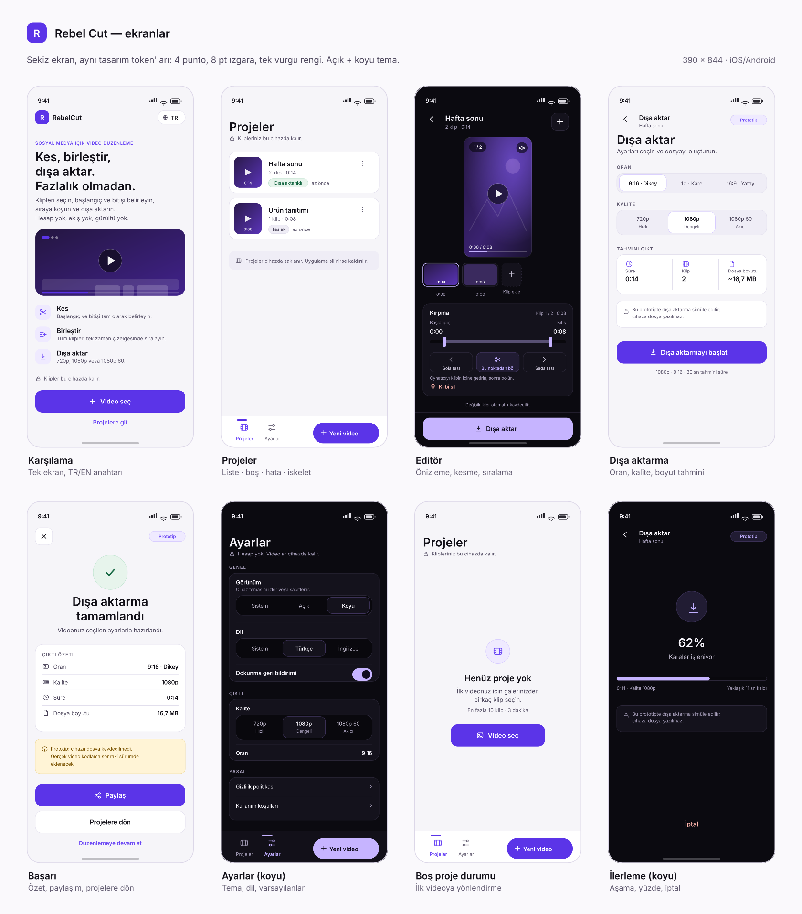

# Rebel Cut — sosyal medya için hızlı, temiz video düzenleme

**Rebel Cut**, Reels / TikTok / Shorts için hızlı kurgu yapan bir mobil uygulama prototipidir.
Galeriden klip seç, başlangıç–bitişi belirle, sırala, oran ve kalite seç, dışa aktar.

- Platform: **iOS + Android** (Expo / React Native), telefon öncelikli, yatayda da çalışır.
- Diller: **Türkçe + İngilizce**, uygulama içinden değiştirilebilir.
- Tema: **açık + koyu**, cihaz temasına uyumlu.
- Durum: **çalışan arayüz prototipi**. Dışa aktarma simüle edilir; cihaza video dosyası yazılmaz.
- Hesap yok, sosyal akış yok, sunucu yok. Projeler cihazda saklanır.

> Prototype not: Video kodlama (encoding) bu sürümde yoktur. Gerçek motor için yol haritası aşağıdadır.

[](docs/visuals/00-genel-bakis.png)

---

## Ekranlar

Sekiz durumun tamamı tek tasarım sisteminden üretildi. Görseller çalışan uygulamanın
ekran görüntüsü değil, `src/theme/tokens.ts` değerlerinden üretilen statik maketlerdir;
uygulama aynı düzeni canlı olarak çizer.

| # | Görsel | Ne gösterir |
| --- | --- | --- |
| 01 | [`01-karsilama.png`](docs/visuals/01-karsilama.png) | Karşılama: tek ekran, TR/EN anahtarı, üç özellik, gizlilik notu |
| 02 | [`02-projeler.png`](docs/visuals/02-projeler.png) | Projeler: dolu liste, durum rozetleri, alt dock + "Yeni video" |
| 03 | [`03-editor.png`](docs/visuals/03-editor.png) | Editör (koyu): önizleme, zaman çizelgesi, kırpma tutamaçları, eylemler |
| 04 | [`04-disa-aktarma.png`](docs/visuals/04-disa-aktarma.png) | Dışa aktarma: oran, kalite, boyut tahmini, prototip notu |
| 05 | [`05-basari.png`](docs/visuals/05-basari.png) | Başarı: çıktı özeti, paylaşım, projelere dön |
| 06 | [`06-ayarlar-koyu.png`](docs/visuals/06-ayarlar-koyu.png) | Ayarlar (koyu): tema, dil, titreşim, çıktı, yasal |
| 07 | [`07-bos-durum.png`](docs/visuals/07-bos-durum.png) | Boş durum: ilk videoya yönlendirme |
| 08 | [`08-disa-aktarma-ilerleme.png`](docs/visuals/08-disa-aktarma-ilerleme.png) | İlerleme (koyu): aşama, yüzde, iptal |

Görselleri yeniden üretmek için: `npm run docs:previews` (SVG kaynakları da aynı klasörde).

---

## Hızlı başlangıç

Gereksinimler: **Node 20+**, npm, telefonda **Expo Go (SDK 58)** veya bir development build.

```bash
npm install

# Telefonda dene (QR kodu)
npm start

# Tarayıcıda dev sunucu
npm run web

# Tip kontrolü
npm run typecheck

# Statik web derlemesi + yerel önizleme (http://0.0.0.0:8081)
npm run preview
```

`npm run preview` önce `dist/` üretir, sonra bağımlılıksız Node sunucusuyla yayınlar
(`scripts/serve-web.mjs`). Yeniden derlemeden sadece sunmak için `npm run serve`.

### Doğrudan derleme (mağaza)

Expo Go dışına çıkarken:

```bash
npx expo prebuild
npx expo run:ios      # macOS + Xcode
npx expo run:android  # Android Studio / SDK
# veya EAS: npx eas build --profile preview
```

`app.json` içindeki `bundleIdentifier` / `package` değerleri (`app.rebelcut.prototype`)
mağaza öncesinde kendi alan adınızla değiştirilmelidir.

---

## Ekran haritası

| Rota | Ekran | Amaç | Ana eylem | Durumlar |
| --- | --- | --- | --- | --- |
| `/` | Karşılama | Ürünü tek ekranda anlat, dili değiştir | Video seç → sekmeler + galeri | onboarding bir kez |
| `/projects` | Projeler | Cihazdaki projeleri listele | Karta dokun → editör | yükleniyor / boş / hata / dolu |
| `/(tabs)/settings` | Ayarlar | Tema, dil, titreşim, varsayılan çıktı, yasal, veri | Ayarı değiştir | kayıt hatası uyarısı |
| `/select` | Klip seç | Galeriden video seç, limitleri kontrol et | Galeriden seç | izin yok / çok klip / süre aşımı / desteklenmeyen |
| `/editor/[id]` | Editör | Kırp, böl, sırala, önizle | Dışa aktar | klip yok / oynatma hatası / süre okunamadı |
| `/export/[id]` | Dışa aktarma | Oran + kalite seç, ilerlemeyi göster | Dışa aktarmayı başlat | ayarlar / işleniyor / iptal |
| `/success/[id]` | Başarı | Çıktı özeti, paylaşım | Paylaş / Projelere dön | özet yoksa hata |
| `/legal/privacy` | Gizlilik | Yerel veri politikası | — | metin |
| `/legal/terms` | Koşullar | Kullanım koşulları | — | metin |

Detaylar: [`docs/screen-map.md`](docs/screen-map.md).

---

## Klasör yapısı

```text
app/                      Expo Router rotaları
  _layout.tsx             Sağlayıcılar, Stack, splash, tema
  index.tsx               Karşılama
  (tabs)/_layout.tsx      JS sekmeler + alt dock
  (tabs)/projects.tsx     Projeler
  (tabs)/settings.tsx     Ayarlar
  select.tsx              Galeri seçimi (yeni proje veya klip ekleme)
  editor/[id].tsx         Zaman çizelgesi, kırpma, önizleme
  export/[id].tsx         Simüle dışa aktarma + ilerleme
  success/[id].tsx        Başarı + özet + paylaşım
  legal/[doc].tsx         Gizlilik / koşullar
src/
  components/             Button, TrimBar, Timeline, ClipPreview, Sheet, dialogs…
  hooks/                  useTheme, useHaptics, useClipThumbnail
  i18n/                   TR/EN sözlükleri, dil çözümü
  store/                  AsyncStorage: projeler, tercihler, onboarding
  theme/tokens.ts         Renk, tipografi, boşluk, radius, hareket, limitler
  utils/                  Format, medya matematiği, picker, süre yoklama, navigasyon
assets/                   İkon, splash, favicon (placeholder üretildi)
docs/                     Tasarım sistemi, ekran haritası, mağaza metni, kararlar
  visuals/                 Ekran maketleri (PNG + SVG)
scripts/                  İkon üretici, web sunucusu
```

---

## Tasarım sistemi özeti

Tam doküman: [`docs/design-system.md`](docs/design-system.md).

- **Vurgu:** dolgu `#5B34E8`, açık temada metin/ikon `#6C48F5`, koyu temada `#C6B4FF`.
- **Yüzeyler:** açık `#F6F5F9` / `#FFFFFF`; koyu `#0B0A10` / `#14121C`.
- **Tipografi:** sistem fontu; 4 boyut (28/20/15/12), 2 ağırlık (400/600).
- **Boşluk:** 4–8 ızgarası (4, 8, 12, 16, 24, 32, 48, 64).
- **Dokunma:** her hedef en az 48 pt; ikon düğmeleri 48, alt dock sekmeleri 52+.
- **Hareket:** 160–200 ms; yalnızca opaklık/ölçek; azaltılmış harekette iskelet sabit.
- **İkonlar:** tek aile — Material Icons.
- **Durumlar:** her veri ekranında yükleniyor (iskelet), boş, hata, başarı, izin yok.

Renkler token dosyasından gelir; ekranlarda ham hex yoktur. Video üzeri katmanlar
`mediaControl`, `mediaTint`, `mediaTrack` gibi ayrı token'larla yönetilir.

---

## Veri ve kalıcılık

- `AsyncStorage` anahtarları: `rebelcut.projects.v1`, `rebelcut.preferences.v1`, `rebelcut.onboarded.v1`.
- Proje modeli: klipler (uri, kaynak süresi, trim başlangıç/bitiş), oran, başlık,
  oluşturma/güncelleme zamanı, durum (`draft` / `exported`), son dışa aktarma özeti.
- Yazma 300 ms birleştirilir; kırpma sürüklerken disk yükü artmaz.
- **Demo klip yoktur.** Tüm videolar kullanıcının galerisinden gelir; örnek kişisel veri yoktur.
- Gerçek kişi, gerçek kart/adres, stok yüz kullanılmaz.

### Geçici medya uyarısı (prototip)

Seçilen video URI'leri işletim sisteminin geçici alanından gelebilir (özellikle web'de `blob:`).
Sayfa yenilenirse veya sistem önbelleği temizlenirse eski projelerin oynatması açılmayabilir.
Bu durumda editör açık bir hata kartı gösterir ve klibi kaldırıp yeniden eklemeyi önerir.
Kalıcı çözüm, gerçek motor sürümünde dosyaları uygulama belgeler dizinine kopyalamaktır.

---

## Prototipin bilinçli sınırları

- **Dışa aktarma simülasyonu:** ilerleme çubukları ve aşamalar gerçek kodlama yerine
  süre tahminiyle çalışır. Başarı ekranında "dosya kaydedilmedi" notu vardır.
- **Paylaşım:** yalnızca metin paylaşımı; dosya paylaşımı yoktur.
- **Kırpma birleştirme:** oynatma, klibi bitiş noktasında duraklatıp sıradaki klibe geçer;
  geçişte kısa bir kare atlaması görülebilir (gerçek zaman çizelgesi motoru yok).
- **Küçük resimler:** native'de `expo-video-thumbnails` ile üretilir; web'de yer tutucu ikon.
- **Limitler:** en fazla 10 klip, toplam 180 sn, minimum 0,5 sn klip, 0,1 sn kırpma adımı.
- **Kapsam dışı:** sosyal akış, sohbet, ödeme/abonelik, harita, kamera kaydı, push bildirim,
  yönetici paneli, hesap/profil, müzik kitaplığı, metin/filtre/geçişler.
- **Ölçüm/analitik yok**, çevrimdışı çalışır (veriler yerel).

---

## Gerçek video motoru için yol

Arayüz, motor kararından bağımsız tutuldu. Gerçek çıktı için önerilen adım:

1. `src/services/exporter.ts` içinde şu imzayı uygulayın:
   `export(project, { preset, aspect }) → { uri, sizeBytes, duration }`.
2. Seçenek A: **FFmpeg tabanlı** paket (`ffmpeg-kit-react-native` türevi). Expo Go'da
   çalışmaz; development build gerekir. Lisans ve paket bakımı kontrol edilmeli.
3. Seçenek B: **platform-native** (iOS `AVAssetExportSession` + `AVVideoComposition`,
   Android `Media3 Transformer`). En iyi kalite/performans; native modül yazımı gerekir.
4. Kırpma listesini zaman çizelgesine çevirip her klip için composition segmenti oluşturun;
   9:16 / 1:1 / 16:9 için `AVAssetWriter`/Transformer ölçekleme ve letterbox uygulayın.
5. Ses: klip seslerini sırayla birleştirin (prototipte klip sesi önizlemede çalar).
6. Çıktıyı `expo-file-system` ile `documentDirectory` altına yazıp `expo-sharing` ile paylaşın.
7. Başarı ekranındaki metin/pill'i gerçek dosya özetiyle değiştirin.

---

## İkon ve marka

Şu an **geçici ikon** kullanılıyor: koyu gradyan üzerinde beyaz "R" ve vurgu renginde
kesim çizgisi. Kullanıcı kendi ikonunu yüklediğinde şu dosyalar değiştirilir:

| Dosya | Boyut | Kullanım |
| --- | --- | --- |
| `assets/icon.png` | 1024×1024 | iOS + genel mağaza ikonu |
| `assets/adaptive-icon.png` | 1024×1024, saydam | Android adaptive foreground |
| `assets/monochrome-icon.png` | 1024×1024, saydam | Android monochrome |
| `assets/splash-icon.png` | 512×512 | Splash marka karosu |
| `assets/favicon.png` | 64×64 | Web |

`npm run icons` placeholder'ı yeniden üretir. Gerçek ikonu koyarken köşe yuvarlaklığını
platforma bırakın (iOS maskeler, Android adaptive maskeler), küçük boyutta okunurluğu test edin.

---

## Erişilebilirlik

- Tüm ikon düğmelerinde görünür/okunur etiket; sekmelerde `role="tab"` + seçili durum.
- Kırpma tutamaçları `adjustable`, artır/azalt eylemleri 1 sn adımlı.
- Dynamic Type: metinler `allowFontScaling`; sabit yükseklikli kutularda taşma yok.
- Azaltılmış hareket: iskelet animasyonu sabit kalır; ekran geçişleri kısa.
- Kontrast: gövde metni ≥ 4.5:1, büyük metin/ikon ≥ 3:1 (açık + koyu temada doğrulandı).
- Yıkıcı eylemlerde kırmızı dolgu yerine onay diyaloğu ve metin düğmesi.

---

## Mağaza metni

Kısa açıklama ve anahtar kelimeler: [`docs/store-listing.md`](docs/store-listing.md).
Prototipte "hesap yok, videolar cihazda kalır" mesajı korunmalı; mağaza sürümünde
gizlilik politikası URL'si zorunludur.

---

## Kilitlenen kararlar ve varsayımlar

- Ad: **Rebel Cut** · kısa ad: **RebelCut** · slogan: "Sosyal medya için hızlı, temiz video."
- Platform: iOS + Android, Expo; telefon öncelikli; yatay düzen çalışır; ayrı tablet düzeni yok.
- Kullanıcı: 18–34 sosyal medya üreticisi; temel sorun yavaş/kalite kaybettiren dışa aktarma.
- MVP: **kes · birleştir · dışa aktar**; 720p / 1080p / 1080p 60; 9:16 / 1:1 / 16:9.
- Akış: tek karşılama → Projeler/Ayarlar + alt dock "Yeni video" → galeri → editör → dışa aktarma → başarı.
- Hesap/profil yok, ücretsiz ve filigransız, demo veri yok, kamera kaydı yok.
- Tema açık + koyu (sisteme uyum), vurgu elektrik moru, sistem fontu, hafif hareket + kısa titreşim.
- Metin tonu kurumsal ve net; TR + EN anahtarı; gizlilik + koşullar; kısa mağaza metni.
- İkon: kullanıcı kendi görselini yükleyene kadar geçici "R + kesim" işareti.
- Varsayımlar: backend yok, örnek klip yok, gerçek kodlama yok, ücretli servis yok.

Değiştirilebilecek 5 karar ve gerekçeleri: [`docs/decisions.md`](docs/decisions.md).

---

## Komutlar

| Komut | Açıklama |
| --- | --- |
| `npm start` | Expo dev sunucusu (QR / Expo Go) |
| `npm run ios` / `npm run android` | Simülatör/emülatörde aç |
| `npm run web` | Tarayıcıda dev sunucu |
| `npm run typecheck` | TypeScript denetimi |
| `npm run export:web` | Statik web derlemesi (`dist/`) |
| `npm run serve` | `dist/` klasörünü 8081'de yayınla |
| `npm run preview` | Derle + yayınla |
| `npm run icons` | Geçici ikonu yeniden üret |
| `npm run docs:previews` | `docs/visuals/` ekran maketlerini yeniden üret |

## Lisans / kullanım

Bu depo bir ürün prototipidir. Gerçek mağaza yayını öncesinde marka adı, paket kimliği,
gizlilik metinleri, gerçek video motoru ve mağaza varlıkları tamamlanmalıdır.
